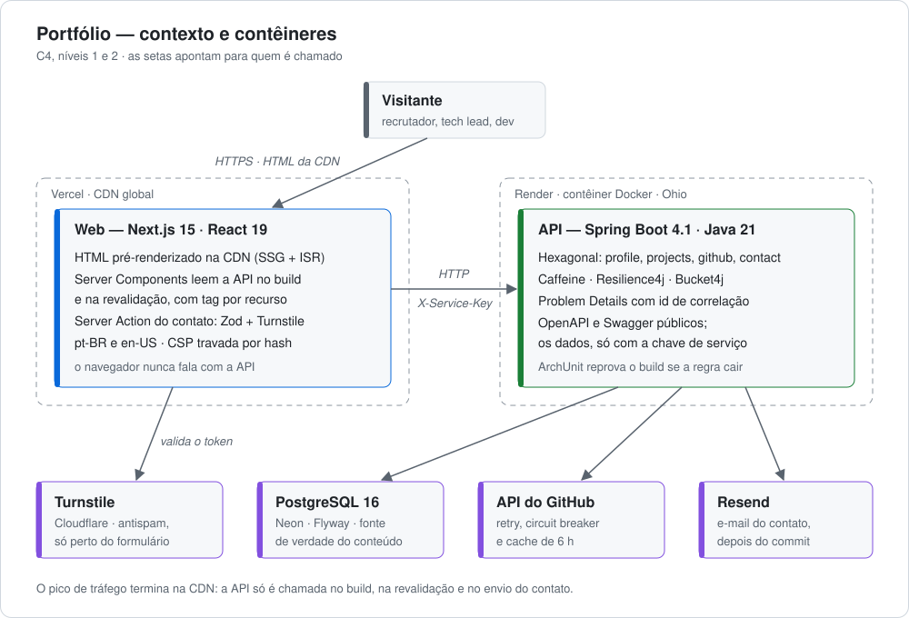
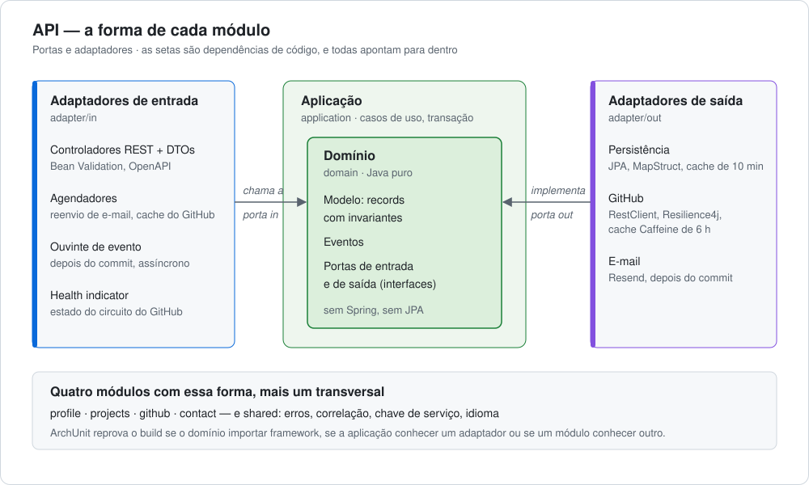

# Portfólio — Crystofer Demetino

[](https://github.com/CrySamuel/portfolio/actions/workflows/ci-web.yml)
[](https://github.com/CrySamuel/portfolio/actions/workflows/ci-api.yml)
[](https://github.com/CrySamuel/portfolio/actions/workflows/e2e.yml)
[](LICENSE)

Portfólio profissional de Desenvolvedor Backend que **não apenas apresenta** competência técnica —
ele **é** a demonstração dela.

A maioria dos portfólios de backend é um site estático que _afirma_ domínio de Spring Boot, Docker e
testes. Este projeto adota a premissa oposta: **o portfólio é o próprio sistema backend**. O conteúdo
exibido na tela vem de uma API Java real, com banco de dados real, cache real, tratamento de falha
real e pipeline de deploy real.

**No ar:** [portfolio-web-coral-tau.vercel.app](https://portfolio-web-coral-tau.vercel.app) ·
**Contrato da API:** [Swagger UI](https://portfolio-api-bx89.onrender.com/swagger-ui/index.html)
(plano gratuito do Render: fora do horário do keep-alive, a primeira abertura leva até um minuto)

---

## Em números

Medidos, não estimados. Os relatórios em [`docs/reports`](docs/reports) trazem o método, a data e o
que ficou de fora.

| O quê                                | Resultado                                                                       | Limite                         |
| ------------------------------------ | ------------------------------------------------------------------------------- | ------------------------------ |
| Lighthouse em produção, celular      | performance **97–100**; acessibilidade, boas práticas e SEO **100**             | ≥ 95                           |
| Peso da home em produção             | **180 KB** transferidos, nenhum pedido a terceiros na carga                     | ≤ 600 KB                       |
| JavaScript por página, comprimido    | **118–123 KB**                                                                  | ≤ 130 KB, no CI                |
| Testes da API                        | **656** — unidade, integração com Testcontainers, WireMock, ArchUnit            | todos verdes                   |
| Cobertura da API                     | **92,8%** das linhas; **97,5%** em `domain` e `application`                     | ≥ 80% por pacote               |
| Testes do web                        | **30** de unidade (Vitest) e **124** de ponta a ponta com axe, em 4 navegadores | zero violações                 |
| Carga na API, 100 usuários por 2 min | p95 de **1,4 s** e mediana de 103 ms, 67 pedidos/s — era 23,6 s antes do cache  | p95 < 200 ms: **não cumprido** |

## Arquitetura



- **O tráfego termina na CDN.** As páginas são pré-renderizadas (SSG) e regeneradas em segundo
  plano (ISR, com tag por recurso). A API só é chamada no build, na revalidação e no envio do
  contato — um pico de visitas não chega até ela, e é por isso que o plano gratuito do Render basta.
  Dentro dela, o conteúdo fica 10 minutos em cache: o teste de carga mostrou o que custava não ter.
- **O navegador nunca fala com a API.** Quem fala é o servidor do Next, que guarda a chave de
  serviço. A API exige a chave em `/api/*` e deixa abertos só o OpenAPI e o actuator (saúde e
  métricas): contrato e números públicos, dados fechados.
- **O contato não perde mensagem.** A mensagem é gravada antes de qualquer envio; o e-mail sai por
  evento, depois do commit, e um agendador reenvia o que falhou. O Turnstile só carrega quando o
  visitante chega perto do formulário — antes, ele custava mais de 700 KB a cada visita à home.
- **O GitHub pode cair sem derrubar o site.** Retry, circuit breaker e cache de 6 horas, com o
  último valor conhecido como resposta de reserva.



A API é um **monólito modular em arquitetura hexagonal**: quatro módulos de negócio com a mesma
forma, e as regras de dependência verificadas por ArchUnit — o domínio não importa framework, a
aplicação não conhece adaptador, e um módulo não conhece o outro. Violar qualquer uma quebra o
build.

### Decisões

Cada escolha que não era óbvia virou um ADR, com contexto, alternativas e consequências — inclusive
as que foram revistas depois.

| ADR                                                                                                           | Decisão                                                            |
| ------------------------------------------------------------------------------------------------------------- | ------------------------------------------------------------------ |
| [0001](docs/PLANO-COMPLETO.md#adr-0001-monorepo-full-stack-com-api-real)                                      | Monorepo full-stack com API real                                   |
| [0003](docs/PLANO-COMPLETO.md#adr-0003-arquitetura-hexagonal-com-monólito-modular)                            | Arquitetura hexagonal com monólito modular                         |
| [0004](docs/PLANO-COMPLETO.md#adr-0004-postgresql-como-fonte-de-verdade-do-conteúdo)                          | PostgreSQL como fonte de verdade do conteúdo                       |
| [0005](docs/PLANO-COMPLETO.md#adr-0005-bff-em-route-handlers-do-nextjs)                                       | O servidor do Next como BFF                                        |
| [0006](docs/PLANO-COMPLETO.md#adr-0006-hospedagem-em-vercel-e-render)                                         | Hospedagem em Vercel e Render                                      |
| [0007](docs/PLANO-COMPLETO.md#adr-0007-ssg-com-isr-e-revalidação-por-tag)                                     | SSG com ISR e revalidação por tag                                  |
| [0008](docs/PLANO-COMPLETO.md#adr-0008-resiliência-na-integração-com-o-github)                                | Resiliência na integração com o GitHub                             |
| [0010](docs/PLANO-COMPLETO.md#adr-0010-postgres-no-neon-emenda-o-adr-0006)                                    | Postgres no Neon                                                   |
| [0011](docs/PLANO-COMPLETO.md#adr-0011-spring-boot-41-substitui-o-adr-0009)                                   | Spring Boot 4.1 (substitui os ADRs 0002 e 0009)                    |
| [0012](docs/PLANO-COMPLETO.md#adr-0012-csp-estática-sem-nonce-emenda-a-seção-24)                              | CSP estática sem nonce                                             |
| [0013](docs/PLANO-COMPLETO.md#adr-0013-conteúdo-bilíngue-no-banco-com-o-idioma-negociado-por-accept-language) | Conteúdo bilíngue no banco, idioma negociado por `Accept-Language` |

## O que reprova uma mudança

Nada disto é convenção: cada item reprova o commit, o push ou o CI. A regra do projeto é validar
cada guarda quebrando-a de propósito, com o resultado previsto antes — as oito regras do ArchUnit,
por exemplo, falharam cada uma pela violação que lhe cabia.

| Onde      | Guarda                                                                                                                                                               |
| --------- | -------------------------------------------------------------------------------------------------------------------------------------------------------------------- |
| commit    | Conventional Commits (commitlint); Prettier, ESLint e Spotless nos arquivos alterados                                                                                |
| push      | a suíte inteira — web e API, com Testcontainers                                                                                                                      |
| CI · api  | formatação (Spotless), testes, ArchUnit, piso de cobertura de 80% por pacote do núcleo                                                                               |
| CI · web  | formatação, lint, tipos, testes de unidade                                                                                                                           |
| E2E · web | build; orçamento de JS; Playwright e axe em Chromium, Firefox, WebKit e celular, contra a API de verdade; Lighthouse CI com os limites de LCP, CLS, TBT, TTFB e peso |

## Stack

| Camada   | Tecnologias                                                                                   |
| -------- | --------------------------------------------------------------------------------------------- |
| Web      | Next.js 15 · React 19 · TypeScript `strict` · Tailwind CSS 4 · next-intl · Zod                |
| API      | Java 21 · Spring Boot 4.1 · Spring Data JPA · MapStruct · Resilience4j · Bucket4j · Caffeine  |
| Dados    | PostgreSQL 16 (Neon) · Flyway                                                                 |
| Testes   | JUnit 5 · Testcontainers · WireMock · ArchUnit · JaCoCo · Vitest · Playwright · axe-core · k6 |
| Infra    | Docker · GitHub Actions · Vercel · Render · Lighthouse CI                                     |
| Monorepo | pnpm workspaces · Turborepo                                                                   |

## Estrutura

```
portfolio/
├── apps/
│   ├── web/          # Next.js 15 — site e BFF
│   └── api/          # Java 21 + Spring Boot — API REST
├── packages/
│   ├── ui/           # Design system (primitivos React)
│   ├── api-client/   # Tipos TypeScript gerados do OpenAPI
│   ├── eslint-config/
│   └── typescript-config/
├── infra/
│   ├── docker/       # Dockerfile da API e Postgres local
│   ├── k6/           # Teste de carga
│   └── scripts/      # keep-alive
├── docs/
│   ├── PLANO-COMPLETO.md
│   ├── diagrams/     # Os diagramas deste README
│   └── reports/      # Lighthouse, cobertura e carga
└── .github/          # Workflows de CI
```

A estrutura de pastas é documentação executável: a arquitetura deve ser inferível pelos nomes, sem
abrir um único arquivo.

## Pré-requisitos

| Ferramenta | Versão                                                               |
| ---------- | -------------------------------------------------------------------- |
| Node.js    | `24.16.0` (ver `.nvmrc`)                                             |
| pnpm       | `11.21.0`                                                            |
| JDK        | `21` (LTS)                                                           |
| Docker     | necessário para o Postgres local e para os testes com Testcontainers |

## Como executar

```bash
pnpm install
```

Sobe o Postgres local (os valores padrão já funcionam sem `.env`):

```bash
pnpm db:up
```

API em `localhost:8080`, com o perfil `local` ativado automaticamente:

```bash
cd apps/api && ./mvnw spring-boot:run
```

Web em `localhost:3000`:

```bash
pnpm --filter @portfolio/web dev
```

| Comando                     | O que faz                                                                |
| --------------------------- | ------------------------------------------------------------------------ |
| `pnpm db:up`                | Sobe o Postgres e espera ficar saudável                                  |
| `pnpm db:down`              | Para o container, preservando os dados                                   |
| `pnpm db:reset`             | Para o container e **apaga o volume**                                    |
| `pnpm lint`                 | ESLint em todos os pacotes                                               |
| `pnpm typecheck`            | `tsc --noEmit`                                                           |
| `pnpm test`                 | Testes de unidade do web                                                 |
| `pnpm format`               | Prettier                                                                 |
| `./mvnw spotless:apply`     | Formata o código Java (dentro de `apps/api`)                             |
| `./mvnw verify`             | Suíte da API e piso de cobertura — **exige Docker rodando**              |
| `pnpm exec playwright test` | Ponta a ponta (dentro de `apps/web`, com a API de pé e o web construído) |
| `pnpm orcamento:js`         | Orçamento de JS por página (dentro de `apps/web`, depois do build)       |

`./mvnw verify` sobe um PostgreSQL 16 descartável por Testcontainers, aplica as migrações Flyway do
zero e valida as entidades JPA contra o schema resultante; o relatório de cobertura sai em
`apps/api/target/site/jacoco/index.html`. O hook de `pre-push` executa as mesmas suítes, então
Docker parado impede o push.

Para variáveis de ambiente, copie [.env.example](.env.example) para `.env`.

## Documentação

- [Plano completo do projeto](docs/PLANO-COMPLETO.md) — visão, arquitetura, stack, design system,
  ADRs e o roteiro de execução em 7 MVPs.
- [Relatórios](docs/reports) — Lighthouse em produção, cobertura e carga, com método e data.
- [Como contribuir](CONTRIBUTING.md) — commits, hooks e o que o CI espera.

## Roadmap

| MVP | Entregável                                                            | Status      |
| --- | --------------------------------------------------------------------- | ----------- |
| 0   | Fundação técnica — monorepo com CI verde                              | ✅ `v0.0.1` |
| 1   | **Portfólio publicado** — link em produção com hero vindo do Postgres | ✅ `v0.1.0` |
| 2   | Perfil completo — sobre, timeline, skills e CV                        | ✅ `v0.2.0` |
| 3   | Prova de trabalho — projetos com filtro e páginas de detalhe          | ✅ `v0.3.0` |
| 4   | Prova de engenharia backend — GitHub com circuit breaker e cache      | ✅ `v0.4.0` |
| 5   | Conversão — formulário de contato ponta a ponta                       | ✅ `v0.5.0` |
| 6   | Alcance e qualidade — SEO, i18n, testes e performance                 | 🚧          |

## Licença

[MIT](LICENSE) © 2026 Crystofer Demetino
